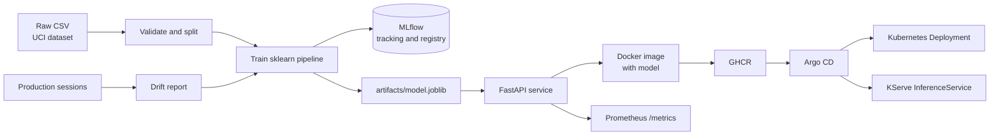

# Purchase Intent MLOps

End-to-end MLOps reference project: a purchase-intent classifier with reproducible
training, experiment tracking, a FastAPI inference service, container images,
Kubernetes and KServe deployment, GitOps delivery and drift monitoring.

[](https://github.com/Kamrank47/purchase-intent-mlops/actions/workflows/ci.yml)
[](LICENSE)
[](pyproject.toml)

## Results

Committed run on the 12,330-session UCI dataset, stratified 80/20 split:

| Metric | Value |
| --- | --- |
| ROC-AUC | 0.927 |
| Average precision | 0.727 |
| Recall | 0.730 |
| Precision | 0.596 |
| F1 at 0.50 | 0.656 |
| Best F1 | 0.666 at threshold 0.55 |
| Training rows | 9,864 |

Full report in `artifacts/metrics.json` after `make train`; model details in
[docs/model-card.md](docs/model-card.md).

## What this project demonstrates

| Concern | Implementation |
| --- | --- |
| Data quality | Schema and dtype validation, binary target checks, dataset SHA-256 recorded per run |
| Reproducible training | Pinned pipeline, fixed seed, CLI entry point, metrics and model artifacts |
| Experiment tracking | MLflow params, metrics, signature and model registry, optional extra |
| Serving | FastAPI with Pydantic validation, `/healthz`, `/model-info`, `/predict`, Prometheus metrics when installed |
| Packaging | Multi-stage Dockerfile, non-root user, read-only root filesystem, health check |
| Kubernetes | Deployment, Service, HPA, PodDisruptionBudget, probes, resource limits, hardened security context |
| KServe | `InferenceService` manifest for serverless sklearn serving |
| GitOps | Kustomize overlays for dev and prod, Argo CD application with auto-sync and pruning |
| Monitoring | Feature drift report with per-feature statistics and an alert threshold, optional Evidently HTML |
| CI/CD | Lint, 23 tests, training smoke run, image build, Trivy scan, manifest validation, GHCR release on tags |

## Architecture



## Quickstart

Python 3.10 or newer. The dataset is committed, so no download is required.

```bash
python -m venv .venv && source .venv/bin/activate
pip install -e ".[dev]"

make train     # trains, writes artifacts/model.joblib and artifacts/metrics.json
make serve     # http://localhost:8000/docs
make test      # 23 tests
```

Prediction request:

```bash
curl -s -X POST http://localhost:8000/predict \
  -H 'Content-Type: application/json' \
  -d '{
    "administrative": 2,
    "administrative_duration": 60.5,
    "informational": 0,
    "informational_duration": 0,
    "product_related": 30,
    "product_related_duration": 1200,
    "bounce_rates": 0.02,
    "exit_rates": 0.03,
    "page_values": 8.5,
    "special_day": 0,
    "month": "Nov",
    "operating_systems": 2,
    "browser": 2,
    "region": 1,
    "traffic_type": 2,
    "visitor_type": "Returning_Visitor",
    "weekend": false
  }'
```

```json
{"prediction":1,"label":"purchase","probability":0.622144,"threshold":0.5}
```

## Experiment tracking

```bash
pip install -e ".[tracking]"

# option A: local SQLite store, no server (recommended)
MLFLOW_TRACKING_URI=sqlite:///mlflow.db intent-train --track

# option B: compose tracking server
docker compose --profile tracking up -d mlflow
MLFLOW_TRACKING_URI=http://localhost:5000 intent-train --track --register-model
mlflow ui --backend-store-uri http://localhost:5000
```

Every run logs the parameters, the eight headline metrics, the dataset hash and a
model signature. `--register-model` promotes the artifact into the MLflow model
registry.

MLflow 3 disables the plain filesystem store by default. SQLite is the simplest
local option; if you specifically want `file:./mlruns`, also set
`MLFLOW_ALLOW_FILE_STORE=true`.

## Docker

```bash
make train
docker build --target with-model -t purchase-intent-mlops:local .
docker run --rm -p 8000:8000 purchase-intent-mlops:local

# or both services
docker compose up --build
```

The `runtime` stage is model-agnostic. The `with-model` stage adds the trained
artifact, which is the image the deployment examples use.

## Kubernetes

```bash
kubectl apply -k k8s/overlays/prod
kubectl -n mlops port-forward service/purchase-intent-api 8000:80
curl -s localhost:8000/healthz
```

The manifests include a rolling update strategy with `maxUnavailable: 0`, readiness
and liveness probes, CPU-based autoscaling, a disruption budget and a container
that runs as non-root with a read-only filesystem.

### KServe

`k8s/kserve/inference-service.yaml` is the serverless alternative. Replace
`storageUri` with a registry or object-storage location that holds the saved
sklearn model, apply it on a cluster with KServe installed, and the same artifact
serves through the KServe sklearn runtime.

## GitOps

`argocd/application.yaml` points Argo CD at `k8s/overlays/prod`. Create the
application once:

```bash
kubectl apply -f argocd/application.yaml
```

Argo CD then syncs every change to `main`, prunes removed resources and self-heals
drift. Image tags are updated in `k8s/overlays/prod/kustomization.yaml` (or by an
image updater), so a release is a Git commit rather than a manual `kubectl` command.

## Monitoring

```bash
make drift
# or compare two batches
intent-monitor --reference data/raw/online_shoppers_intention.csv \
  --current data/raw/online_shoppers_intention.csv --output artifacts/drift.json
```

The report contains a per-feature statistic, a drifted flag, the share of drifted
features and an alert flag at 30%. Numeric features use mean shift in standard
deviations; categorical features use total variation distance. Install
`.[monitoring]` to also produce an Evidently HTML report. The service exposes
Prometheus metrics on `/metrics` when `prometheus-fastapi-instrumentator` is
installed.

## CI/CD

`.github/workflows/ci.yml` runs on every push and pull request:

1. Ruff and the full test suite
2. Training on the committed dataset plus a drift smoke test, uploading model artifacts
3. Image build with Trivy scanning for critical vulnerabilities
4. `kubeconform` validation of the Kubernetes manifests

`.github/workflows/release.yml` runs on tags (`v0.1.0`), retrains the model, builds
the `with-model` image and pushes semver tags to GHCR using `GITHUB_TOKEN`.

## Repository layout

```text
src/intent_mlops/     config, data, features, evaluation, training, serving, monitoring
tests/                data, model, API and drift tests
data/raw/             committed dataset plus provenance
k8s/base              Deployment, Service, HPA, PDB
k8s/overlays          dev and prod overlays
k8s/kserve            InferenceService for serverless serving
argocd/               Argo CD application
docs/model-card.md    intended use, evaluation and limitations
scripts/fetch_data.py download and checksum verification
```

## Design decisions

- **Dataset in Git.** 1.1 MB with a pinned SHA-256 keeps the project runnable for
  reviewers. Production data belongs in object storage and a versioned feature store.
- **Random forest baseline.** Fast, stable on tabular data and easy to explain.
  The interface is a scikit-learn pipeline, so swapping in gradient boosting is local.
- **Threshold reported, not hidden.** The default API threshold is 0.50; the evaluation
  also reports the best-F1 threshold of 0.55, which is the more useful operating point
  for this class balance.
- **Model baked only into the deployment target.** The base runtime image stays
  reusable; the deployment image and the registry hold the artifact.
- **No secrets in the repository.** CI uses `GITHUB_TOKEN`; the optional MLflow
  server runs locally with a SQLite backend.

## Limitations and next steps

- Add a temporal split and probability calibration before treating scores as expected values.
- Move artifacts to the MLflow registry at deploy time instead of baking them into the image.
- Add canary releases with Argo Rollouts and automated rollback on error budget burn.
- Wire drift alerts and SLOs to Alertmanager and Grafana.

## Data and license

Code is MIT licensed. The dataset is CC BY 4.0; attribution and citation are in
[data/README.md](data/README.md).
